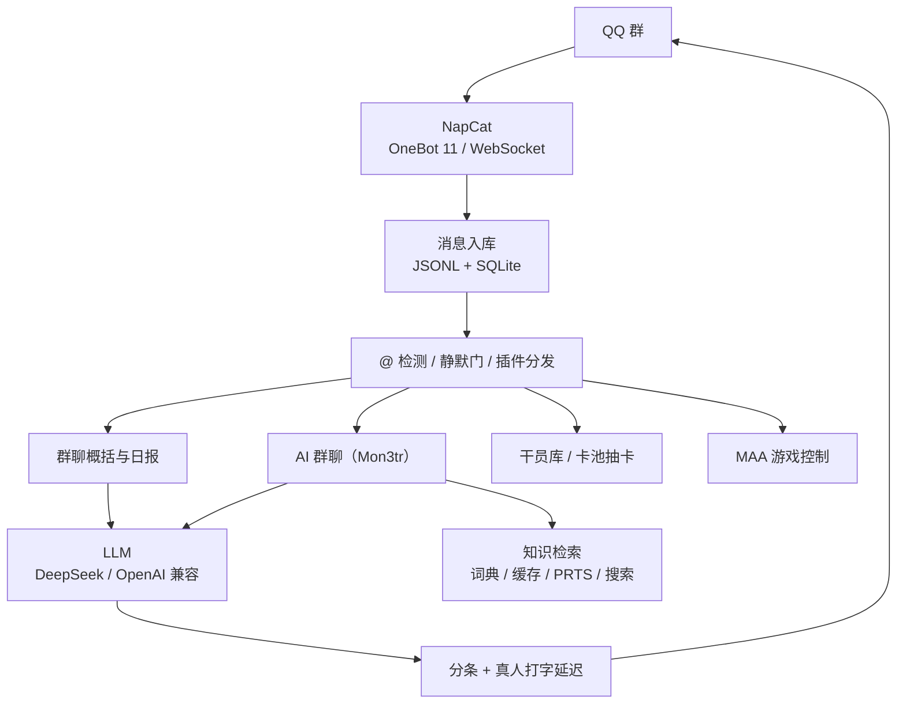

<div align="center">

<h1>Mon3tr Bot</h1>

<p><b>明日方舟主题的 QQ 群聊 AI 机器人</b><br/>
群聊概括 · 每日日报 · 本地干员库 · 真实卡池抽卡 · MAA 游戏控制</p>

<p>


</p>

<p>
<a href="docs/index.md">📚 文档</a> ·
<a href="#快速开始">🚀 快速开始</a> ·
<a href="#指令一览">🎛 指令</a> ·
<a href="#配置">⚙️ 配置</a> ·
<a href="#常见问题">❓ 常见问题</a>
</p>

</div>

---

## 它是什么

> 一个住在 QQ 群里的 Mon3tr（M3）：会接梗、会记仇也会记你的好，顺手把群聊概括、方舟数据和 MAA 一条龙都干了。

- **有人味的 AI 群友**：Mon3tr 人设、群昵称上下文、用户记忆、按时段的情绪、先反应再回答，回复按真人打字速度分条发送
- **干活也不含糊**：手动/每日群聊概括、离线消息补偿、本地干员库与真实卡池抽卡、PRTS / 萌娘 / 联网搜索、Web 管理面板
- **想打游戏时**：主人在群里发 `maa 日常`，模拟器没开就自动拉起 MuMu，游戏没开就由 MAA 打开并跑到主界面
- **工程上克制**：Node ESM、仅一个第三方依赖（`ws`）、零网络测试、密钥与运行数据永不进仓库



---

## 功能特性

### 🗒 群聊概括与日报

- **手动概括**：群里 @机器人 说「总结」（关键词可配 `commands.manualSummary`），生成话题 / 关键信息 / 待办 / 氛围四段式概括
- **每日日报**：默认 9:00（`report.hour/minute`）统计昨日各群消息，活跃群（≥100 条）日报以**合并转发**私聊发给指定 QQ；启动 / 断线错过 9:00 会自动补跑一次（同一天不重复）
- **敏感内容过滤**：硬违规词与真实隐私值（手机号 / 邮箱 / 身份证 / 银行卡 / 地址 / IP）送 LLM 前过滤；隐私词只在「自述具体值」或「索取」句式下命中——「密码学」「防诈骗」这类正常讨论不再被误删
- **离线补偿**：按群水位补齐掉线期间错过的消息（内置风控降险节流）

### 💬 Mon3tr AI 群聊

- **人设**：凯尔希曾经的共生体、如今独立行动的罗德岛医疗干员（链愈师）——外表强大、内心单纯呆萌，会一本正经说萌话、口是心非
- **群聊习惯**：先反应再回答、只说对方要的那一点、短句碎句、允许不确定和平淡；不列点、不客服腔、不固定开场白
- **实名上下文**：以群昵称识别发言者，可理解「他 / 她 / 刚才那位」；QQ 号绝不进入上下文
- **用户记忆**：`记住 …` 按群隔离（每人 50 条 / 全局 2000 条），对话后自动提取；事实带重要性 / 强度 / 最近使用，相似内容自动合并；低重要性事实 120 天不用会淡忘（手动记的永不删）；`我的记忆` / `忘记我` 自助管理
- **长期记忆**：对话历史落盘 `data/chat_history/<群号>.json`（重启续接）；每天日报后把「今天群里的小事」提炼成 3–5 条，最近 3 天作为背景注入
- **工具调用**：贴表情（386 QQ 官方表情 + 193 Unicode）、发表情（一次多个合并发送）、查干员 / 藏品 / 卡池 / 群统计、检索群历史、查或记用户记忆
- **自我管理**：可修改昵称 / 签名 / 本群名片；主人可让她修改文档与人格提示词（`prompts/chat-system.md`，即改即生效，白名单限定）
- **像真人打字**：首条约 1.5–9s（读题 + 按字数打字约 70ms/字 + ±20% 抖动），40 字以上按句拆 1–3 条短消息；所有回复都知道当前时段
- **回复不 @ 人**：默认纯文本（`llm.replyAtUser: true` 可恢复真 @）；试点群一律不 @
- **免 @ 自动接话**（试点群）：接不接由模型自己判断（`<NO_REPLY>` 即沉默），会识别「@ 的是别人」，时段 07:00–22:30，同群冷却 + 每小时上限，不叠话
- **深度思考**：数学 / 证明 / 代码类重问题自动开启思考模式（`llm.thinking: "auto"`），闲聊保持快速
- **戳一戳**：有人戳机器人等同找她，会正常接话

### 🎲 明日方舟数据（本地秒回）

- **本地干员库**（`data/ark/`，来自 [ArknightsGameData](https://github.com/Kengxxiao/ArknightsGameData)）：1392 干员 / 442 档案 / 1773 肉鸽藏品 / 455 卡池（随笔库更新变化）；生日、资料、藏品效果**本地秒回**
- **语义模糊匹配**：bigram Dice 相似度（「波登克」→「波登可」、「高卢的支票本」→「高卢银行支票」）
- **真实卡池抽卡**：6★2% / 5★8% / 4★50% / 3★40%，UP 占其星级 50%；`卡池` / `单抽` / `十连` / `N 连`（中文数字，上限 1000）/ `抽卡记录 [N]` / `谁最欧`；十连以上自动改用**合并转发**卡片
- **数据自动更新**：每 24h 从镜像拉取，ETag 比对 + 结构校验 + 原子写入 + 内存热重载

### 🔎 知识检索（本地优先，联网兜底）

本地梗词典 → 知识缓存（TTL 168h）→ 联网检索（PRTS.Wiki / 联网搜索 / 萌娘百科 / 维基百科），按来源可信度与热度排序。

- **检索门提速**：闲聊跳过联网检索，提问才检索（`llm.retrievalGate`）
- **联网搜索**：默认 DeepSeek 官方 Search API（复用 `llm.apiKey`）；也可切 `zhipu` / `bocha`
- **群友教词典**：`学习 词=释义` / `忘记 词` / `查词 词` / `词典`（词条至少 2 个字）

### 🎮 游戏控制（MAA，可选，仅主人）

把 [MAA](https://github.com/MaaAssistantArknights/MaaAssistantArknights) 接进群：本机 Python 桥驱动 MaaCore，刷完把结果与掉落发回群。

- **一条龙**：`maa 日常 CE-6 5` = 唤醒 → 刷图 → 公招 → 基建 → 信用 → 奖励（全部完成才回报）
- **长任务**：`maa 肉鸽 萨米 0 1`（傀影 / 水月 / 萨米 / 萨卡兹 / 界园 / 黑洞）、`maa 生息 RA15`，单任务超时放宽到 240 分钟
- **模拟器自动启动**：模拟器 / 游戏都没开时发 `maa 唤醒`，worker 自动用 `MuMuManager.exe control -v 0 launch` 拉起模拟器，等 adb 连上后由 MAA 打开游戏（`start_game_enabled`），最多等 120s
- **真抽卡**（默认关）：二次确认后执行，会消耗真实合成玉 / 寻访凭证，结束后补结果截图
- **边界**：同一时刻只跑一个任务；`maa.*` 仅主人可用；不抢占 MAA GUI 控制权

### 🛠 管理与工程

- **Web 管理面板**（`http://127.0.0.1:5210`）：运行状态、词典增删、用户记忆查看 / 删除、数据刷新、配置查看（密钥脱敏）
- **SQLite 分析层**：`活跃榜 [N天]` / `群统计` / 抽卡记录（均按当前群统计，不跨群泄露）
- **插件架构**：core（装配 / 路由 / 平台服务 / 知识单例）+ plugins（7 指令 + 5 功能插件），**377 项测试**纯本地零网络
- **风控降险内置**：backfill 节流、重连退避、贴表情冷却、出站过滤

---

## 指令一览

> 所有指令都要 @机器人 触发；未命中的内容走 AI 群聊。

| 分类 | 指令 |
|---|---|
| 总结 | `总结`（关键词可配） |
| 词典 | `学习 词=释义`、`忘记 词`、`查词 词`、`词典` |
| 用户记忆 | `记住 …`、`我的记忆`、`忘记我` |
| 干员 / 藏品 | `查干员 X`、`查藏品 X`、`干员生日 X`、`今日生日` |
| 抽卡 | `卡池`、`单抽 [池]`、`十连 [池]`、`N 连 [池]`（中文数字也可，上限 1000）、`抽卡记录 [N]`、`谁最欧` |
| 统计 | `活跃榜 [N天]`、`群统计` |
| 平台状态 | `#status`、`/status` |
| 数据 | `刷新数据` |

### MAA（仅主人，需 `maa.enabled`）

| 指令 | 说明 |
|---|---|
| `maa 状态` / `maa 重连` / `maa 停止` | 连接状态 / 重连设备 / 停止当前任务 |
| `maa 唤醒` | 启动模拟器（未开时）+ 打开游戏到主界面 |
| `maa 日常 [关卡] [次数]` | 一条龙：唤醒 → 公招 → 基建 → 信用 → 奖励（带关卡则加刷图） |
| `maa 刷图 <关卡> [次数]` | 如 `maa 刷图 CE-6 5` |
| `maa 公招 [次数]` / `maa 基建` / `maa 领奖励` / `maa 信用 [商品]` | 对应日常任务 |
| `maa 肉鸽 <主题> [模式] [次数]` | 傀影 / 水月 / 萨米 / 萨卡兹 / 界园 / 黑洞 |
| `maa 生息 [0\|1\|RA1\|RA15\|RA4]` | 生息演算 |
| `maa 截图` / `maa 关闭` / `maa 自定义 <任务链>` | 截图到群 / 关闭游戏 / 自定义任务链 |
| `maa 抽卡十连` / `maa 抽卡单抽` + `maa 确认` | 真抽卡（需 `maa.allowGacha`，二次确认） |

---

## 快速开始

### 环境要求

| 依赖 | 说明 |
|---|---|
| **Node.js ≥ 22.5** | 使用 `node:sqlite` |
| **[NapCat](https://github.com/NapNeko/NapCatQQ)** | QQ 登录与 OneBot 11 正向 WS |
| **LLM API** | DeepSeek 或任意 OpenAI 兼容接口 |
| **MAA + 模拟器**（可选） | 游戏控制；Windows + MuMu 开箱即用 |

### 1. 准备 NapCat（推荐 NCD 桌面管理工具）

1. 安装 [NapCatQQ-Desktop](https://github.com/NapNeko/NapCatQQ-Desktop/releases)（NCD）
2. NCD「组件」页依次安装 **Node.js / QQ / NapCat**
3. 「机器人」页创建实例：填机器人 QQ → 底座 NapCat → 连接新增「WS 正向服务器」端口 `3001`（记下 token）
4. 保存并启动，手机 QQ 扫码登录机器人账号

> 残留其他 QQ 账号登录态时，到 `C:\Users\<你>\AppData\Roaming\QQ\Partitions` 删除旧 `qqnt_<旧号>` 目录，并清理 NapCat 配置里旧账号的 `onebot11_<旧号>.json` 再重启。
> 扫码提示 `serverErrorCode: 168` 是 QQ 风控：需手机 QQ 完成安全验证后再扫码；**强烈建议使用小号**。

### 2. 安装

```bash
git clone https://github.com/CoastChen-dev/qq-group-summary-bot.git
cd qq-group-summary-bot
npm install
cp config.example.json config.json    # 按需修改
```

### 3. 配置 `config.json`

| 必填 | 说明 |
|---|---|
| `napcat.wsUrl` / `napcat.selfId` / `napcat.accessToken` | NapCat 连接信息 |
| `llm.apiKey` | LLM 密钥（也可用环境变量 `LLM_API_KEY`） |
| `report.userId` | 日报私聊接收人（不填不发日报） |
| `groups` | 监控群白名单，`[]` = 全部群 |

常用开关：`llm.chatEnabled`、`quiet`、`tools.enabled`、`emojiLike.enabled`、`memory.enabled`、`webSearch.provider`、`owner.userId`、`webui.enabled`、`dataRetention.days`。完整键表见 [docs/config-reference.md](docs/config-reference.md)。

### 4. 本地干员数据库（可选，强烈推荐）

```bash
# 干员基础数据（约 14MB）
curl -o data/ark/character_table.json \
  https://cdn.jsdelivr.net/gh/Kengxxiao/ArknightsGameData@master/zh_CN/gamedata/excel/character_table.json
# 干员档案（含生日 / 种族 / 简介，约 5.5MB）
curl -o data/ark/handbook_info_table.json \
  https://cdn.jsdelivr.net/gh/Kengxxiao/ArknightsGameData@master/zh_CN/gamedata/excel/handbook_info_table.json
# 肉鸽藏品（约 17MB）
curl -o data/ark/roguelike_topic_table.json \
  https://cdn.jsdelivr.net/gh/Kengxxiao/ArknightsGameData@master/zh_CN/gamedata/excel/roguelike_topic_table.json
# 真实卡池数据（约 436KB）
curl -o data/ark/gacha_table.json \
  https://cdn.jsdelivr.net/gh/Kengxxiao/ArknightsGameData@master/zh_CN/gamedata/excel/gacha_table.json
```

> 也可以什么都不放，等 `dataRefresh` 首次自动更新（默认启动 30 分钟后）。
> 仓库另提供 `lingo.example.json` 词典模板（38 条常用绰号 / 梗），可复制为 `data/lingo.json`；`data/` 已被 `.gitignore` 排除。

### 5. 启动

```bash
npm start    # 或 Windows 双击 start_bot.bat
npm test     # 全量测试（纯本地零网络；测试日志走临时目录，LOG_DIR 可覆盖）
```

看到 `QQ 群聊概括机器人已启动（仅 @ 触发总结；每日 9:00 发送昨日日报）` 即正常。

---

## 配置

详细键表与默认值见 [docs/config-reference.md](docs/config-reference.md)。几个最常改的：

| 键 | 默认 | 用途 |
|---|---|---|
| `llm.model` / `llm.baseUrl` | DeepSeek | 换模型或兼容端点 |
| `llm.replyAtUser` | `false` | 回复是否真 @ 提问者 |
| `llm.humanize.*` | 见文档 | 分条 / 打字延迟（`typingMsPerChar` 默认 70ms/字） |
| `report.hour` / `report.minute` | `9` / `0` | 日报触发时刻 |
| `backfill.*` | 见文档 | 离线补偿与风控节流 |
| `dataRetention.days` | `0` | N 天后自动清理消息（0 = 永不删除） |
| `webui.enabled` | `true` | 本机管理面板 |

---

## 目录结构

```
src/
  index.js      引导入口（import { main }）
  core/         主运行库
    runtime.js    createApp(config, overrides) 纯装配 + start/stop + main()
    registry.js   插件注册表（priority 分发带 / hooks 生命周期）
    routing.js    S1–S13 消息路由判定链 + 离线补偿（backfill）
    platform/     napcat.js store.js summarizer.js scheduler.js analytics.js refresher.js
                  usermem.js emoji.js filter.js logger.js http.js text.js lifecycle.js maa.js
    knowledge/    lingo.js arkdb.js cache.js wiki.js moegirl.js wikipedia.js websearch.js
  plugins/      功能插件（互不 import；服务经 createApp 注入）
    memory.js lingo.js ark.js gacha.js stats.js status.js   指令插件（带 750–350）
    summary.js refresh.js report.js              后台流程（总结 / 数据更新 / 日报）
    chat.js    AI 群聊 ChatBrain + 工具表 createChatTools + 兜底分发
    webui.js   Web 管理面板
    maa.js     MAA 游戏控制指令（带 380，仅主人）
tools/maa_bridge/worker.py   MAA 桥（Python + MaaCore，本机 HTTP）
test/           node:test：baseline/（行为基线）+ smoke/（接线与全链冒烟）
prompts/        人格提示词（chat-system.md，她可自我编辑、即改即生效）
config.example.json / config.json   配置模板 / 实配（密钥，gitignored）
logs/ data/                         日志（按天轮转）/ 运行数据（消息 / 状态 / 库 / 记忆）
```

---

## 测试与开发

```bash
npm test          # 全量 377 例，纯本地零网络；测试日志走临时目录，LOG_DIR 可覆盖
node --check src/<file>.js   # 单文件语法自检
```

- 测试分两层：`test/baseline/` 直测行为基线（store / analytics / lingo / arkdb / 指令），`test/smoke/` 验证导入面、注册表、插件接线与全链冒烟
- 改了路由链、插件、存储语义就跑全量；纯文档 / 注释改动可跳过
- 深层文档入口：[docs/index.md](docs/index.md)（架构、配置、数据格式、对外接口、重构存档）

---

## 降低风控风险（重要）

QQ 对自动化账号有阶梯式风控（提示 → 限制 → 冻结 → 永久）。本项目内置降险：

- **backfill 降险**：距上次在线不足 5 分钟整体跳过；单群水位 <2 分钟跳过；分页拉取（每页 200 条、最多 5 页）；群间 / 页间错峰 300ms
- **重连退避**：3s 起指数退避、30s 封顶；连接稳定 30s 后才复位
- **贴表情 / 发表情节流**：同群 5s / 3s 冷却
- **回复限流**：同一人 3s 冷却、同群 20 次/分钟
- **出站过滤**：只拦隐私模式与硬词；讨论「密码 / 诈骗 / 自杀」不再整条替换

账号侧建议：

- **务必用小号，不要用主号**
- **控制重启频率**：调试先跑 `npm test`，别连真机
- **禁止对真机做批量接口探测**（表情全量枚举、循环拉历史、批量发消息）——本仓库曾因此吃过 7 天冻结
- 登录环境稳定（固定设备 / 网络），NapCat 保持最新版
- 被群友举报是最大风控来源：控制回复频率与内容
- 被风控后：手机 QQ 安全验证 → 等 1–7 天 → 换网络重试，不要反复扫码硬试

---

## 常见问题

<details>
<summary><b>连不上 NapCat / @机器人 不响应</b></summary>

确认 NapCat 已登录并开启正向 WS，检查 `wsUrl` / `accessToken`；掉线时机器人按退避自动重连。@ 不响应时确认机器人已进群、`groups` 未漏配（「@昵称」与「@QQ号」均兼容）。

</details>

<details>
<summary><b>LLM 报错</b></summary>

检查 `llm.apiKey` / `llm.baseUrl` / `llm.model`；DeepSeek 与任意 OpenAI 兼容端点均可。

</details>

<details>
<summary><b>日报没发送</b></summary>

确认 `report.userId`、昨日消息数 ≥ `report.minMessages`（日报只统计昨日）；若 9:00 时进程不在线，启动后会自动补跑一次（同一天不重复）。

</details>

<details>
<summary><b>重启后重复概括 / 磁盘越来越大</b></summary>

概括进度持久化在 `data/state/`，正常不会重复。历史消息默认永久保留（`dataRetention.days` 默认 0）；设成如 `30` 会在每次启动时清理 30 天前的 JSONL 与 SQLite 行（先清理再导入）。

</details>

<details>
<summary><b>NapCat 提示「未找到对应版本的偏移数据」</b></summary>

NapCat 对最新 QQ 的适配滞后，关注其更新。

</details>

---

## 致谢

| 项目 | 用途 |
|---|---|
| [NapCat](https://github.com/NapNeko/NapCatQQ) | QQ / OneBot 11 接入 |
| [MAA](https://github.com/MaaAssistantArknights/MaaAssistantArknights) | 明日方舟自动化 |
| [ArknightsGameData](https://github.com/Kengxxiao/ArknightsGameData) | 本地干员 / 藏品 / 卡池数据 |
| [PRTS.Wiki](https://prts.wiki/) / [萌娘百科](https://zh.moegirl.org.cn/) | 知识检索 |
| [DeepSeek](https://www.deepseek.com/) | 默认 LLM 与联网搜索 |

---

## 说明

- 摘要与回复由 LLM 生成，仅供群内参考，不作为事实依据
- 聊天记录与记忆保存在本地 `data/`，请妥善保管、注意隐私；`config.json` 含密钥且已被 `.gitignore` 排除
- 敏感内容规则见 [`src/core/platform/filter.js`](src/core/platform/filter.js)，可按需调整

<div align="center">
<sub>如果这个项目对你有帮助，欢迎点个 ⭐</sub>
</div>
